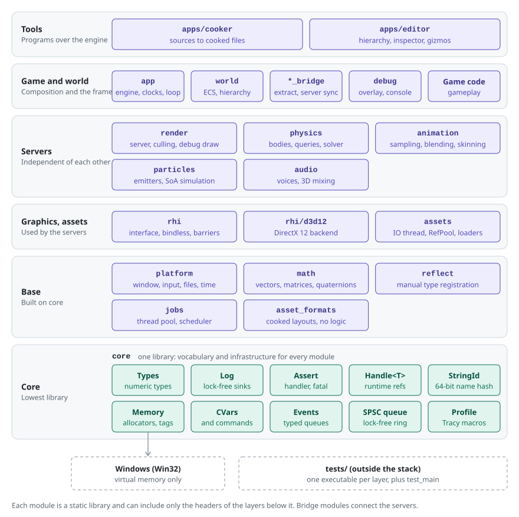
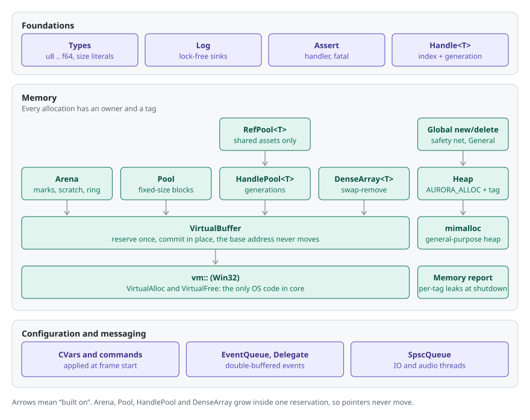
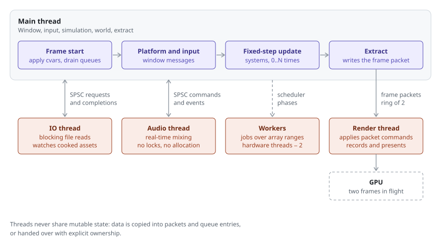
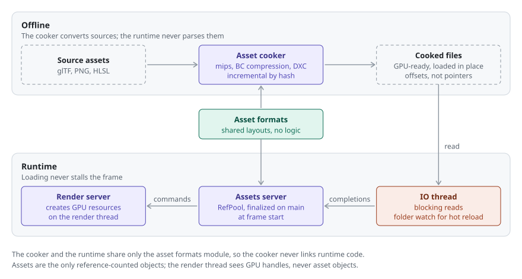

# Aurora Engine

Aurora is a 3D game engine written from scratch in C++20 as a learning project. It targets Windows through the Win32 API and renders with DirectX 12.

> **Status:** Stage 1 (Foundation), step 1: the core layer. Build system, logging, assertions, unit tests and the memory infrastructure (virtual memory, heap, arenas, pools, handles, reference counting, dense arrays, leak reports) are in place. Next: console variables and events. See the [roadmap](docs/roadmap.md).

**Documentation:** [docs/](docs/README.md) has a guide for each part of the engine: the ideas behind it, how to use it, when to use it and when not to, and its restrictions.

## Goals

- **Learn how an engine works by building its architecture by hand.** The platform layer, math, physics, the rendering hardware interface (RHI) over DirectX 12, the renderer, the ECS, the asset system and cooker, reflection, the job system, the console, events, animation, particles and the editor are all written from scratch.
- **Use libraries only for specialized domains** that teach little about engine architecture:

| Library | Use | Status |
|---|---|---|
| [mimalloc](https://github.com/microsoft/mimalloc) | General-purpose heap behind `core/memory` | Integrated |
| [doctest](https://github.com/doctest/doctest) | Unit tests, only in `tests/` | Integrated |
| [Dear ImGui](https://github.com/ocornut/imgui) | Debug overlay, console window, editor UI | Planned |
| [cgltf](https://github.com/jkuhlmann/cgltf), [stb_image](https://github.com/nothings/stb) | Reading glTF and images, only inside the asset cooker | Planned |
| A BC texture compressor (to be chosen) | Texture compression inside the asset cooker | Planned |
| [DXC](https://github.com/microsoft/DirectXShaderCompiler) | Offline HLSL compilation | Planned |
| [miniaudio](https://github.com/mackron/miniaudio) | Audio backend | Planned |
| [Tracy](https://github.com/wolfpld/tracy) | Profiler | Planned |

- **Keep every milestone visible.** Each step ends with something running on screen or a test passing.
- **Closed scopes.** Each system gets a minimal, complete first version; extensions are listed and deferred.

## Quick start

Requirements: Windows 10 or 11 (x64) and Visual Studio 2026 with the **Desktop development with C++** workload, which includes MSVC, CMake and Ninja.

From a **Developer PowerShell for VS 2026**:

```powershell
cmake --preset windows-ninja
cmake --build --preset ninja-debug
ctest --preset ninja-debug
.\build\windows-ninja\bin\Debug\sandbox.exe
```

For a Visual Studio solution, use `cmake --preset windows-vs` and open `build\windows-vs\aurora.sln`; F5 runs the sandbox. In VS Code, the CMake Tools extension with the `windows-ninja` preset works without a Developer PowerShell.

More in [Building](docs/build.md) (presets, options, compiler flags, precompiled header, adding a layer) and [Testing](docs/testing.md) (writing tests, testing asserts, adding tests for a layer).

### The sandbox

The sandbox exercises the core layer. Optional arguments show the failure paths:

| Argument | Debug | Release |
|---|---|---|
| `--assert` | Logs the failed assertion and breaks into the debugger | Assertion is compiled out; the program continues |
| `--fatal` | Logs the error, breaks into the debugger, then aborts | Logs the error and aborts |
| `--leak` | Leaks 64 bytes; the shutdown report lists them with file and line | Leaks 64 bytes; the shutdown report lists the tag |

At exit, the sandbox prints the [shutdown memory report](docs/core/memory/memory-report.md).

## Architecture

<picture>
  <source media="(prefers-color-scheme: dark)" srcset="docs/images/architecture-dark.svg">
  
</picture>

Each module is a static library that can include only the headers of the layers below it, which the build enforces. Servers never depend on each other; the world connects them, and `app::Engine` owns them all. Objects refer to each other through generational handles; every allocation has an explicit owner; the renderer never reads the world directly; threads exchange copies, not shared state. See [Architecture](docs/architecture.md).

### Inside the core layer

<picture>
  <source media="(prefers-color-scheme: dark)" srcset="docs/images/core-dark.svg">
  
</picture>

### Threads

The main thread runs the frame. The render, IO and audio threads, and later a pool of workers, receive work only through frame packets and queues.

<picture>
  <source media="(prefers-color-scheme: dark)" srcset="docs/images/threads-dark.svg">
  
</picture>

### Assets

<picture>
  <source media="(prefers-color-scheme: dark)" srcset="docs/images/asset-pipeline-dark.svg">
  
</picture>

### Core layer (implemented)

| Area | Guide |
|---|---|
| Types, logging, assertions | [types](docs/core/types.md) · [logging](docs/core/logging.md) · [assertions](docs/core/assertions.md) |
| Memory | [Choosing an allocator](docs/core/memory/README.md): [virtual memory](docs/core/memory/virtual-memory.md) · [heap](docs/core/memory/heap.md) · [arena](docs/core/memory/arena.md) · [pools and handles](docs/core/memory/pools.md) · [reference counting](docs/core/memory/ref-pool.md) · [dense array](docs/core/memory/dense-array.md) · [memory report](docs/core/memory/memory-report.md) |

## Repository layout

```
AuroraEngine/
├── apps/sandbox/          Test application for the engine
├── cmake/                 Build helpers: flags, precompiled header, engine_add_layer(), engine_add_executable()
├── docs/                  Architecture and subsystem guides; diagrams in docs/images/
├── engine/
│   ├── core/              Types, logging, assertions, memory
│   └── platform/          Placeholder (step 2)
├── tests/
│   ├── framework/         Test main (doctest) and CHECK_ASSERTS
│   └── core/              Unit tests for the core layer
├── CMakeLists.txt
└── CMakePresets.json
```

## Roadmap

| Stage | Steps | Status |
|---|---|---|
| 1. Foundation | Build and core · Platform · Math | In progress (core) |
| 2. First image | DirectX 12 triangle · RHI · Render server | |
| 3. World | ECS · Hierarchy, extract and render thread · Assets and cooker | |
| 4. Image and simulation | Lighting · Collision · Solver | |
| 5. Motion and effects | Animation · Particles | |
| 6. Tools and scale | Reflection and serialization · Editor · Jobs and audio | |

Every step, its scope and its "done when" criterion: [docs/roadmap.md](docs/roadmap.md).

## Conventions

- Namespace `aurora`; every macro starts with `AURORA_`; targets are aliased `aurora::<layer>`.
- No exceptions in engine code. Programming errors are assertions; expected failures are return values.
- UTF-8 for all source code and strings. Conversion to UTF-16 happens only inside Win32 code.
- Every shared structure has a documented threading contract, and every allocation has a named owner.
- Code comments are short and explain only what the code cannot say; the guides in `docs/` explain the rest.
