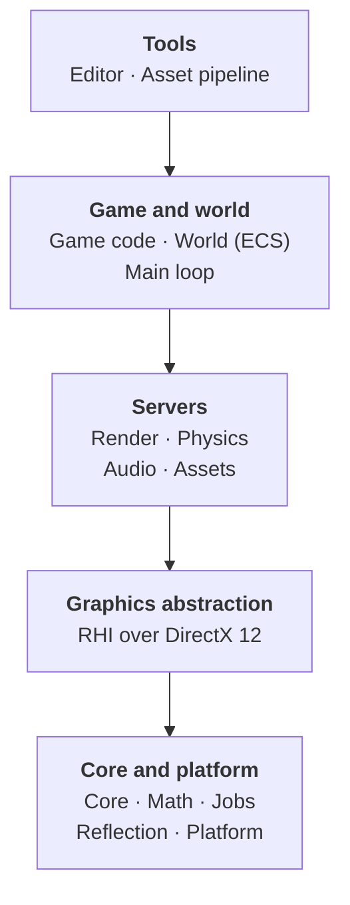

# Aurora Engine

Aurora is a 3D game engine written from scratch in C++20 as a learning project. It targets Windows through the Win32 API and renders with DirectX 12.

> **Status:** early development, Stage 1 (Foundation). The build system and the core module (types, logging, assertions) are in place. The [Target architecture](#target-architecture) and [Roadmap](#roadmap) sections describe where the engine is going, not what exists today.

## Goals

- **Learn how an engine works by building its architecture by hand.** The platform layer (window, input, files), math, physics, the rendering hardware interface (RHI) over DirectX 12, the renderer, the ECS, the asset system, reflection, the job system and the editor are all written from scratch.
- **Use libraries only for specialized domains** that teach little about engine architecture: Dear ImGui (editor UI), cgltf and stb_image (file formats), miniaudio (audio) and Tracy (profiler). None of these are integrated yet.
- **Keep every milestone visible.** Each step of the [roadmap](#roadmap) ends with something running on screen or a test passing.

## Requirements

- Windows 10 or 11, x64.
- Visual Studio 2026 with the **Desktop development with C++** workload. The workload includes MSVC, the Windows SDK, CMake and Ninja.
- CMake 3.25 or newer for the Ninja preset. The `Visual Studio 18 2026` generator used by the solution preset requires CMake 4.2 or newer; the CMake bundled with Visual Studio 2026 qualifies.

## Building

The project uses [CMake presets](CMakePresets.json). There are two configure presets:

| Configure preset | Generator | Use it for |
|---|---|---|
| `windows-ninja` | Ninja Multi-Config | Command line, VS Code, Visual Studio "Open Folder" |
| `windows-vs` | Visual Studio 18 2026 | A `.sln` solution for Visual Studio 2026 |

Build presets: `ninja-debug`, `ninja-release`, `ninja-relwithdebinfo`, `vs-debug`, `vs-release`, `vs-relwithdebinfo`.

### Visual Studio 2026 solution

From a **Developer PowerShell for VS 2026**:

```powershell
cmake --preset windows-vs
start build\windows-vs\aurora.sln
```

`sandbox` is already set as the startup project, so F5 runs it.

### Ninja (command line)

From a **Developer PowerShell for VS 2026**. A regular terminal does not have MSVC and Ninja on its `PATH`:

```powershell
cmake --preset windows-ninja
cmake --build --preset ninja-debug
.\build\windows-ninja\bin\Debug\sandbox.exe
```

### VS Code

Install the **CMake Tools** extension, select the `windows-ninja` configure preset and use the **CMake: Configure**, **CMake: Build** and **CMake: Debug** commands. CMake Tools sets up the MSVC environment by itself. If you want to type `cmake` in the integrated terminal, start VS Code from a Developer PowerShell (`code .`) so the terminal inherits that environment.

### Running the sandbox

The sandbox exercises the core module. Two optional arguments show the failure paths:

| Argument | Debug | Release |
|---|---|---|
| `--assert` | Logs the failed assertion and breaks into the debugger | Assertion is compiled out; the program continues |
| `--fatal` | Logs the error, breaks into the debugger, then aborts | Logs the error and aborts |

## Repository layout

```
AuroraEngine/
├── apps/
│   └── sandbox/                  Test application for the engine
├── cmake/
│   └── EngineBuildHelpers.cmake  engine_add_layer() and engine_add_executable()
├── engine/
│   ├── core/                     Types, logging, assertions
│   ├── math/                     Placeholder (Stage 1, step 3)
│   └── platform/                 Placeholder (Stage 1, step 2)
├── CMakeLists.txt
└── CMakePresets.json
```

### The layer rule

Each engine layer is a static library created with `engine_add_layer()`:

```cmake
engine_add_layer(platform
    SOURCES src/win32_window.cpp
    DEPS    aurora::core)
```

A layer exposes only its own `include/` folder and can only see the headers of the layers it links. Public headers live in `<layer>/include/<layer>/` and are included as `#include "<layer>/file.h"`. If `core` tries to include `"platform/window.h"`, the build fails, because that path does not exist for `core`. The architecture is checked by the compiler, not by convention.

## Core module

### `core/types.h`

Fixed-size numeric types (`u8` to `u64`, `i8` to `i64`, `f32`, `f64`, `usize`, `uptr`, `iptr`), the size literals `_KB`, `_MB` and `_GB`, and the `AURORA_DEBUG` build flag (1 in Debug, 0 otherwise). Compile-time checks enforce the engine's platform assumptions: 64-bit pointers and IEEE 754 floats.

### `core/log.h`

```cpp
AURORA_LOG_INFO("window created: {}x{}", width, height);
AURORA_LOG_WARN("texture {} is not a power of two", name);
AURORA_LOG_TRACE("frame {} took {} ms", frame, ms);   // Debug only
```

- Formatting uses `std::format`, so a wrong format string is a compile error.
- Messages are formatted into a stack buffer with no heap allocation. Messages longer than 1024 characters are truncated and end with `...`.
- `logging::min_level` drops lower levels at compile time: `Trace` messages generate no code outside Debug, but are still type-checked.
- Output goes through **sinks**, functions registered with `logging::add_sink()`. A console sink that writes to `stderr` is registered by default.
- Logging is **lock-free** in engine code: each thread formats into its own buffer and calls the sinks directly. New sinks are published with release/acquire ordering, so a sink can be added while other threads are logging.

Sink contract: a sink may be called from several threads at once, so it must be thread-safe, and it must not log. Sinks cannot be removed, and only the main thread may call `add_sink()`.

### `core/assert.h`

```cpp
AURORA_ASSERT(index < count);
AURORA_ASSERT(index < count, "index {} out of bounds [0, {})", index, count);
AURORA_FATAL("could not create the D3D12 device: {}", code);
AURORA_UNREACHABLE();
```

| Macro | Debug | Release |
|---|---|---|
| `AURORA_ASSERT(cond, ...)` | Evaluates `cond`; on failure logs and breaks into the debugger | Not evaluated, no code generated |
| `AURORA_FATAL(...)` | Logs, breaks into the debugger, aborts | Logs and aborts |
| `AURORA_UNREACHABLE()` | Same as `AURORA_FATAL` | Same as `AURORA_FATAL` |

An assert condition **must never have side effects**, because it disappears in Release. Store the result first:

```cpp
const bool closed = close_handle(h);
AURORA_ASSERT(closed);
```

Assertions are for programming errors. Expected failures, such as a missing file, are reported through return values.

## Target architecture

Aurora is organized in five layers. Each layer depends only on the layers below it, and the [layer rule](#the-layer-rule) enforces this at build time.



| Layer | Modules | Responsibility |
|---|---|---|
| Tools | `editor`, asset pipeline | Separate programs that use the engine as a library. The game never depends on them. |
| Game and world | game code, `world` | Entities, components, systems, the transform hierarchy and the frame loop |
| Servers | `render`, `physics`, `audio`, `assets` | Self-contained subsystems with low-level, handle-based APIs |
| Graphics abstraction | `rhi` | A thin interface over DirectX 12: resources, descriptors, barriers, command lists |
| Core and platform | `core`, `math`, `jobs`, `reflect`, `platform` | Everything the rest of the engine builds on |

### Planned repository layout

```
AuroraEngine/
├── apps/
│   ├── editor/          Editor (Dear ImGui)
│   └── sandbox/         Test game
├── engine/
│   ├── core/            Memory, handles, log, assert, containers
│   ├── math/            Vectors, matrices, quaternions
│   ├── platform/        platform.h + win32/
│   ├── jobs/            Thread pool and tasks
│   ├── reflect/         Type and field registration
│   ├── rhi/             Interface + d3d12/
│   ├── render/          Render server, extract, debug draw
│   ├── assets/          Loading, reference counting, hot reload
│   ├── physics/         Integration, broadphase, narrowphase, solver
│   ├── audio/           Audio server over miniaudio
│   └── world/           ECS, hierarchy, scheduler, main loop
├── shaders/             HLSL
├── tests/               Unit tests, starting with math and physics
└── third_party/         imgui, cgltf, stb_image, miniaudio, tracy
```

## Roadmap

Five stages and fifteen steps. Each step depends only on the previous ones and has a clear "done when" criterion.

| # | Step | Scope | Done when | Status |
|---|---|---|---|---|
| **Stage 1** | **Foundation** | | | |
| 1 | Build and core | CMake layers, log, assert, test framework, arena, `HandlePool` | The sandbox logs and a test shows a stale handle returns `nullptr` | In progress |
| 2 | Platform | Win32 window with DPI awareness, fixed-step loop, input, file reading | The window resizes, input is logged, the step counter matches real time | |
| 3 | Math | Documented conventions, vectors, matrices, quaternions, camera | Unit tests pass, including comparisons with DirectXMath | |
| **Stage 2** | **First image** | | | |
| 4 | DirectX 12 triangle | Device, swap chain, two frames in flight, debug layer | A triangle on screen with no debug layer errors | |
| 5 | RHI | Buffers, textures, bindless descriptors, upload ring, barriers | The triangle again, with no D3D12 call outside `rhi/d3d12/` | |
| 6 | Render server | Meshes and camera through handles, basic Lambert lighting, debug draw, ImGui overlay | A free camera flying around lit cubes, with a debug grid and frame time panel | |
| **Stage 3** | **World** | | | |
| 7 | ECS | Entities as handles, contiguous components, queries | A thousand moving entities | |
| 8 | Hierarchy and extract | Parent/child transforms, formal extract step | A working "solar system", and `render` includes nothing from `world` | |
| 9 | Assets | glTF and textures, reference-counted handles, hot reload | A textured glTF model, and editing a shader updates the image live | |
| **Stage 4** | **Image and simulation** | | | |
| 10 | Lighting | PBR materials, one shadowed directional light, point lights, simple render graph | A glTF scene with shadows and distinct materials | |
| 11 | Collision | Rigid bodies, uniform grid broadphase, sphere and box narrowphase | Spheres and boxes fall and bounce, with contacts drawn by debug draw | |
| 12 | Solver | Sequential impulses, friction, warm starting, sleeping | A stack of 10 boxes stands still | |
| **Stage 5** | **Tools and scale** | | | |
| 13 | Reflection | Manual type registration, scene save and load | A saved scene reloads identically | |
| 14 | Editor | Entity hierarchy, inspector, gizmos, play and stop | A scene is built and played without touching code | |
| 15 | Jobs and audio | Thread pool, parallel systems, audio server | Tracy shows work spread across cores, and collisions play sounds | |

Step 10 has a closed scope on purpose: ambient occlusion, reflections and cascaded shadows wait until after physics, so the renderer does not absorb months before the rest of the engine exists.

## Conventions

- Namespace `aurora`; every macro starts with `AURORA_`.
- No exceptions in engine code. Programming errors are assertions; expected failures are return values.
- UTF-8 for all source code and strings. Conversion to UTF-16 happens only inside the Win32 platform layer.
- Warnings are errors (`ENGINE_WARNINGS_AS_ERRORS`, on by default), with `/W4 /permissive-` on MSVC.
- C++20. Engine code avoids deep inheritance and virtual calls on hot paths; interfaces are reserved for boundaries such as the RHI.