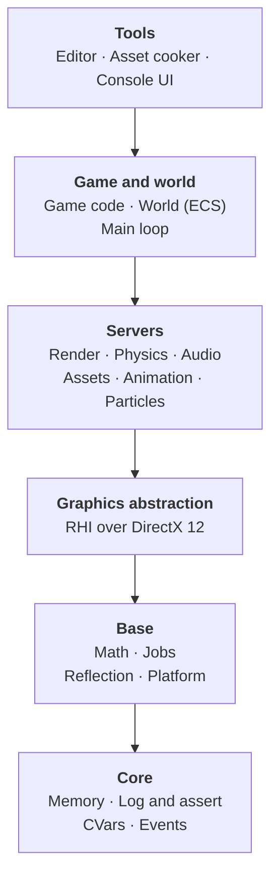

# Aurora Engine

Aurora is a 3D game engine written from scratch in C++20 as a learning project. It targets Windows through the Win32 API and renders with DirectX 12.

> **Status:** early development, Stage 1 (Foundation), step 1 (core layer). The build system, logging, assertions and unit tests are in place (sub-steps 1.1 to 1.3). Next is the memory infrastructure (1.4 onwards). The [Target architecture](#target-architecture) and [Roadmap](#roadmap) sections describe where the engine is going, not what exists today.

## Goals

- **Learn how an engine works by building its architecture by hand.** The platform layer (window, input, files, time), math, physics, the rendering hardware interface (RHI) over DirectX 12, the renderer, the ECS, the asset system and cooker, reflection, the job system, the console and cvars, events, animation, particles and the editor are all written from scratch.
- **Use libraries only for specialized domains** that teach little about engine architecture. mimalloc and doctest are integrated; the others come with the steps that need them:

| Library | Use |
|---|---|
| [mimalloc](https://github.com/microsoft/mimalloc) | General-purpose heap behind `core/memory` |
| [Dear ImGui](https://github.com/ocornut/imgui) | Debug overlay, console window, editor UI |
| [cgltf](https://github.com/jkuhlmann/cgltf), [stb_image](https://github.com/nothings/stb) | Reading glTF and images, only inside the asset cooker |
| A BC texture compressor (to be chosen) | Texture compression inside the asset cooker |
| [DXC](https://github.com/microsoft/DirectXShaderCompiler) | Offline HLSL compilation |
| [miniaudio](https://github.com/mackron/miniaudio) | Audio backend |
| [Tracy](https://github.com/wolfpld/tracy) | Profiler |
| [doctest](https://github.com/doctest/doctest) | Unit tests, only in `tests/` |

- **Keep every milestone visible.** Each step of the [roadmap](#roadmap) ends with something running on screen or a test passing.
- **Closed scopes.** Each system gets a minimal, complete first version; extensions are listed and deferred.

## Requirements

- Windows 10 or 11, x64.
- Visual Studio 2026 with the **Desktop development with C++** workload. The workload includes MSVC, the Windows SDK, CMake and Ninja.
- CMake 3.25 or newer for the Ninja preset. The `Visual Studio 18 2026` generator used by the solution preset requires CMake 4.2 or newer; the CMake bundled with Visual Studio 2026 qualifies.

## Building

The project uses [CMake presets](CMakePresets.json). There are two configure presets:

| Configure preset | Generator | Use it for |
|---|---|---|
| `windows-ninja` | Ninja Multi-Config | Command line, VS Code, Visual Studio "Open Folder" |
| `windows-vs` | Visual Studio 18 2026 | A `.sln` solution for Visual Studio 2026 |

Build presets: `ninja-debug`, `ninja-release`, `ninja-relwithdebinfo`, `vs-debug`, `vs-release`, `vs-relwithdebinfo`.

### Visual Studio 2026 solution

From a **Developer PowerShell for VS 2026**:

```powershell
cmake --preset windows-vs
start build\windows-vs\aurora.sln
```

`sandbox` is already set as the startup project, so F5 runs it.

### Ninja (command line)

From a **Developer PowerShell for VS 2026**. A regular terminal does not have MSVC and Ninja on its `PATH`:

```powershell
cmake --preset windows-ninja
cmake --build --preset ninja-debug
.\build\windows-ninja\bin\Debug\sandbox.exe
```

### VS Code

Install the **CMake Tools** extension, select the `windows-ninja` configure preset and use the **CMake: Configure**, **CMake: Build** and **CMake: Debug** commands. CMake Tools sets up the MSVC environment by itself. If you want to type `cmake` in the integrated terminal, start VS Code from a Developer PowerShell (`code .`) so the terminal inherits that environment.

### Compiler settings

MSVC builds with `/W4 /permissive- /utf-8 /Zc:preprocessor /Zc:__cplusplus /MP`. Warnings are errors (`/WX`) while the `ENGINE_WARNINGS_AS_ERRORS` option is on, which is the default.

Engine targets use a precompiled header with the standard library headers that the core headers include (`<format>`, `<atomic>`, `<string_view>` and a few others). It is controlled by the `ENGINE_USE_PCH` option, on by default. Engine headers are not precompiled, so every file still includes what it uses; configure with `-DENGINE_USE_PCH=OFF` from time to time to check that.

### Running the tests

Unit tests use [doctest](https://github.com/doctest/doctest), fetched by CMake at a pinned version, and run through CTest. They are built by default; configure with `-DENGINE_BUILD_TESTS=OFF` to skip them.

```powershell
cmake --build --preset ninja-debug
ctest --preset ninja-debug
```

Each test case is a separate CTest entry, so failures show by name. Test suites become CTest labels, so `ctest --preset ninja-debug -L log` runs only the logging tests. The test executable can also be run directly, for example `.\build\windows-ninja\bin\Debug\core_tests.exe --test-case="*assert*"`.

Each layer has its own test executable (`core_tests`, later `math_tests` and so on). To add a test file, list it in `tests/<layer>/CMakeLists.txt`; to add a layer, create that file with `engine_add_tests(<layer> SOURCES ... DEPS aurora::<layer>)` and add the folder to `tests/CMakeLists.txt`.

### Running the sandbox

The sandbox exercises the core module. Two optional arguments show the failure paths:

| Argument | Debug | Release |
|---|---|---|
| `--assert` | Logs the failed assertion and breaks into the debugger | Assertion is compiled out; the program continues |
| `--fatal` | Logs the error, breaks into the debugger, then aborts | Logs the error and aborts |

## Repository layout

```
AuroraEngine/
├── apps/
│   └── sandbox/                  Test application for the engine
├── cmake/
│   └── EngineBuildHelpers.cmake  Compiler flags, precompiled header, engine_add_layer(), engine_add_executable()
├── engine/
│   ├── core/                     Types, logging, assertions, memory
│   └── platform/                 Placeholder (Stage 1, step 2)
├── tests/
│   ├── framework/                Test main (doctest) and CHECK_ASSERTS
│   └── core/                     Unit tests for the core module (core_tests)
├── CMakeLists.txt
└── CMakePresets.json
```

### The layer rule

Each engine layer is a static library created with `engine_add_layer()`:

```cmake
engine_add_layer(platform
    SOURCES src/win32_window.cpp
    DEPS    aurora::core)
```

A layer exposes only its own `include/` folder and can only see the headers of the layers it links. Public headers live in `<layer>/include/<layer>/` and are included as `#include "<layer>/file.h"`. If `core` tries to include `"platform/window.h"`, the build fails, because that path does not exist for `core`. The architecture is checked by the compiler, not by convention.

One exception is planned: `core` will call the operating system for virtual memory only (reserve, commit, release), isolated in a single file, because arenas and pools live in `core` and need OS pages. Everything else that touches the OS belongs to `platform`.

## Core module

### `core/types.h`

Fixed-size numeric types (`u8` to `u64`, `i8` to `i64`, `f32`, `f64`, `usize`, `uptr`, `iptr`), the size literals `_KB`, `_MB` and `_GB`, and the `AURORA_DEBUG` build flag (1 in Debug, 0 otherwise). Compile-time checks enforce the engine's platform assumptions: 64-bit pointers and IEEE 754 floats.

### `core/log.h`

```cpp
AURORA_LOG_INFO("window created: {}x{}", width, height);
AURORA_LOG_WARN("texture {} is not a power of two", name);
AURORA_LOG_TRACE("frame {} took {} ms", frame, ms);   // Debug only
```

- Formatting uses `std::format`, so a wrong format string is a compile error. The header only packs the arguments; the formatting itself is compiled once, in `log.cpp`.
- Messages are formatted into a stack buffer with no heap allocation. Messages longer than 1024 characters are truncated and end with `...`.
- `logging::min_level` drops lower levels at compile time: `Trace` messages generate no code outside Debug, but are still type-checked.
- Output goes through **sinks**, functions registered with `logging::add_sink()`. A console sink that writes to `stderr` is registered by default.
- Logging is **lock-free** in engine code: each thread formats into its own buffer and calls the sinks directly. New sinks are published with release/acquire ordering, so a sink can be added while other threads are logging. The only remaining lock is the one the C runtime takes inside `fprintf`.

Sink contract: a sink may be called from several threads at once, so it must be thread-safe, and it must not log. Sinks cannot be removed, at most 8 can be registered, and only the main thread may call `add_sink()`.

### `core/assert.h`

```cpp
AURORA_ASSERT(index < count);
AURORA_ASSERT(index < count, "index {} out of bounds [0, {})", index, count);
AURORA_FATAL("could not create the D3D12 device: {}", code);
AURORA_UNREACHABLE();
```

| Macro | Debug | Release |
|---|---|---|
| `AURORA_ASSERT(cond, ...)` | Evaluates `cond`; on failure logs and breaks into the debugger | Not evaluated, no code generated (still type-checked) |
| `AURORA_FATAL(...)` | Logs, breaks into the debugger, aborts | Logs and aborts |
| `AURORA_UNREACHABLE()` | Same as `AURORA_FATAL` | Same as `AURORA_FATAL` |

An assert condition **must never have side effects**, because it disappears in Release. Store the result first:

```cpp
const bool closed = close_handle(h);
AURORA_ASSERT(closed);
```

Assertions are for programming errors. Expected failures, such as a missing file, are reported through return values.

`aurora::set_assert_handler()` replaces what happens after a failure is logged: the handler returns whether to break into the debugger. The test runner installs a handler that counts failures instead of breaking, so tests can check that an assert fires with `CHECK_ASSERTS(statement)`. `AURORA_FATAL` always aborts, whatever the handler returns.

### `core/memory`

```cpp
VirtualBuffer buffer;                       // reserved address space that grows by commit
if (buffer.reserve(1_GB) && buffer.ensure_committed(64_MB)) { /* buffer.data() never moves */ }

void* block = AURORA_ALLOC(256, 64, MemoryTag::Core);   // records file and line in Debug
heap::free(block, MemoryTag::Core);
heap::report_leaks();                       // live memory per tag; live callsites in Debug
```

- `vm::` wraps the operating system's virtual memory (reserve, commit, decommit, release). It is the only Windows-specific code in `core`.
- `VirtualBuffer` reserves a large address range and commits pages as it grows, so its base address never changes. Arenas, pools and dense arrays will be built on it.
- The heap is [mimalloc](https://github.com/microsoft/mimalloc) with per-tag statistics (live bytes, live blocks, total allocations). The global `new` and `delete` are replaced in every engine executable and counted under `MemoryTag::General`, so standard containers show up in the statistics.
- In Debug builds the heap records the file and line of each `AURORA_ALLOC`, detects frees with the wrong tag or of unknown pointers, and fills freed memory with `0xDD`.

## Target architecture

Aurora is organized in layers. Each layer depends only on the layers below it, and the [layer rule](#the-layer-rule) enforces this at build time.



| Layer | Modules | Responsibility |
|---|---|---|
| Tools | `editor`, `cooker`, console UI | Programs and overlays that use the engine as a library. The game never depends on the editor or the cooker. |
| Game and world | game code, `world` | Entities, components, systems, the transform hierarchy, event queues and the frame loop |
| Servers | `render`, `physics`, `audio`, `assets`, `animation`, `particles` | Self-contained subsystems with low-level, handle-based APIs |
| Graphics abstraction | `rhi` | A thin interface over DirectX 12: resources, bindless descriptors, barriers, command lists |
| Base | `math`, `jobs`, `reflect`, `platform` | Math library, thread pool, type registration, window, input, files and time |
| Core | `core` | Memory (arenas, pools, handles, heap tracking), log, assert, cvars and commands, events |

Key ideas:

- **Generational handles instead of pointers.** References between engine objects are an index plus a generation, so a stale reference is detected immediately.
- **Explicit ownership, no garbage collector.** Every allocation has an owner that frees it: a pool, an arena, a level heap. Reference counting is used only for shared assets.
- **ECS with a transform hierarchy**, and **servers with handle-based APIs**, connected by an **extract step**: the renderer never reads the world.
- **Typed event queues** instead of a global event bus.
- **Cooked assets only at runtime.** Source formats (glTF, PNG, HLSL) are converted offline by the cooker; the runtime loads binary, GPU-ready data.
- **Dedicated threads with fixed roles, then a worker pool.** The main thread simulates frame *k+1* while the render thread records frame *k* and the GPU executes frame *k−1*. An IO thread loads assets and an audio thread mixes sound. A job system parallelizes the heavy systems last.

```
time ─────────────────────────────────────────────>
Main    [ sim+extract 3 ][ sim+extract 4 ][ sim+extract 5 ]
Render          [ record 2 ][ record 3 ][ record 4 ]
GPU                    [ frame 1 ][ frame 2 ][ frame 3 ]
```

- **Avoid sharing before reaching for locks.** Threads exchange copies or hand over ownership. Lock-free code is limited to a few small, tested primitives, and locks stay off hot paths.

### Planned repository layout

```
AuroraEngine/
├── apps/
│   ├── cooker/          Asset cooker
│   ├── editor/          Editor (Dear ImGui)
│   └── sandbox/         Test game
├── engine/
│   ├── core/            Types, log, assert, memory, cvars, events
│   ├── math/            Vectors, matrices, quaternions, transforms
│   ├── platform/        platform.h + win32/
│   ├── jobs/            Thread pool and tasks
│   ├── reflect/         Type and field registration
│   ├── rhi/             Interface + d3d12/
│   ├── render/          Render server, extract, debug draw, debug overlay
│   ├── assets/          Cooked-format loader, reference-counted handles, hot reload
│   ├── asset_formats/   Cooked-format definitions shared by the cooker and the loader
│   ├── physics/         Integration, broadphase, narrowphase, solver
│   ├── animation/       Skeletons, clips, sampling, blending
│   ├── particles/       Emitters, simulation, instanced rendering data
│   ├── audio/           Audio server over miniaudio
│   └── world/           ECS, hierarchy, scheduler, main loop
├── shaders/             HLSL
├── tests/
│   ├── framework/       Test main (doctest) and test helpers
│   └── <layer>/         Unit tests for each layer
└── third_party/         imgui, cgltf, stb_image, miniaudio, tracy
                         (mimalloc and doctest are fetched by CMake at pinned versions)
```

## Roadmap

Six stages and seventeen steps. Each step depends only on the previous ones and has a clear "done when" criterion.

| # | Step | Scope | Done when | Status |
|---|---|---|---|---|
| **Stage 1** | **Foundation** | | | |
| 1 | Build and core | CMake layers, log, assert, tests, virtual memory, heap tracking, arenas, pools and handles, dense arrays, cvars, events | The sandbox logs, a leak is reported with file and line, and a test shows a stale handle returns `nullptr` | In progress |
| 2 | Platform | Win32 window with DPI awareness, fixed-step loop, input, files, time | The window resizes, input is logged, the step counter matches real time | |
| 3 | Math | Documented conventions, vectors, matrices, quaternions, transforms, camera | Unit tests pass, including comparisons with DirectXMath | |
| **Stage 2** | **First image** | | | |
| 4 | DirectX 12 triangle | Device, swap chain, two frames in flight, shaders compiled offline, debug layer | A triangle on screen with no debug layer errors | |
| 5 | RHI | Buffers, textures, bindless descriptors, upload ring, barriers | The triangle again, with no D3D12 call outside `rhi/d3d12/` | |
| 6 | Render server | Meshes and camera through handles, basic Lambert lighting, debug draw, ImGui overlay, console | A free camera flying around lit cubes, with a debug grid, a frame time panel and cvars editable live | |
| **Stage 3** | **World** | | | |
| 7 | ECS | Entities as handles, contiguous components, queries, event queues | A thousand moving entities | |
| 8 | Hierarchy, extract and render thread | Parent/child transforms, formal extract step, render thread fed by frame packets | A working "solar system", `render` includes nothing from `world`, and the scene runs the same with the render thread on or off | |
| 9 | Assets and cooker | Asset cooker (meshes, textures, shaders, incremental), cooked-format loader, reference-counted handles, IO thread, hot reload | A cooked glTF model renders textured, loading does not stall the frame, and editing a source asset updates the running game | |
| **Stage 4** | **Image and simulation** | | | |
| 10 | Lighting | PBR materials, one shadowed directional light, point lights, simple render graph | A glTF scene with shadows and distinct materials | |
| 11 | Collision | Rigid bodies, uniform grid broadphase, sphere and box narrowphase | Spheres and boxes fall and bounce, with contacts drawn by debug draw | |
| 12 | Solver | Sequential impulses, friction, warm starting, sleeping | A stack of 10 boxes stands still | |
| **Stage 5** | **Motion and effects** | | | |
| 13 | Animation | Skeleton sampling, GPU skinning, crossfade | A skinned glTF character plays and crossfades between two clips | |
| 14 | Particles | Dense attribute arrays, one emitter type, instanced billboards, sorted transparent pass | An emitter renders correctly blended in the lit scene | |
| **Stage 6** | **Tools and scale** | | | |
| 15 | Reflection and serialization | Manual type registration, scene save and load | A saved scene reloads identically | |
| 16 | Editor | Entity hierarchy, inspector, gizmos, play and stop | A scene is built and played without touching code | |
| 17 | Jobs and audio | Thread pool, parallel systems, audio server with a lock-free audio thread | Tracy shows work spread across cores, and collisions play sounds | |

Steps have closed scopes on purpose. For example, ambient occlusion, reflections and cascaded shadows wait until after physics, so the renderer does not absorb months before the rest of the engine exists.

## Conventions

- Namespace `aurora`; every macro starts with `AURORA_`; targets are aliased `aurora::<layer>`.
- No exceptions in engine code. Programming errors are assertions; expected failures are return values. Test code in `tests/` may use exceptions.
- UTF-8 for all source code and strings. Conversion to UTF-16 happens only inside Win32 code.
- Every shared structure has a documented threading contract: who writes, who reads, on which thread, how they synchronize and which lock remains. Every allocation has a named owner.
- Code comments are short and explain only what the code cannot. Memory orderings are always explicit.
- Math: right-handed, Y up, column vectors, column-major matrices, reversed-Z depth, radians.