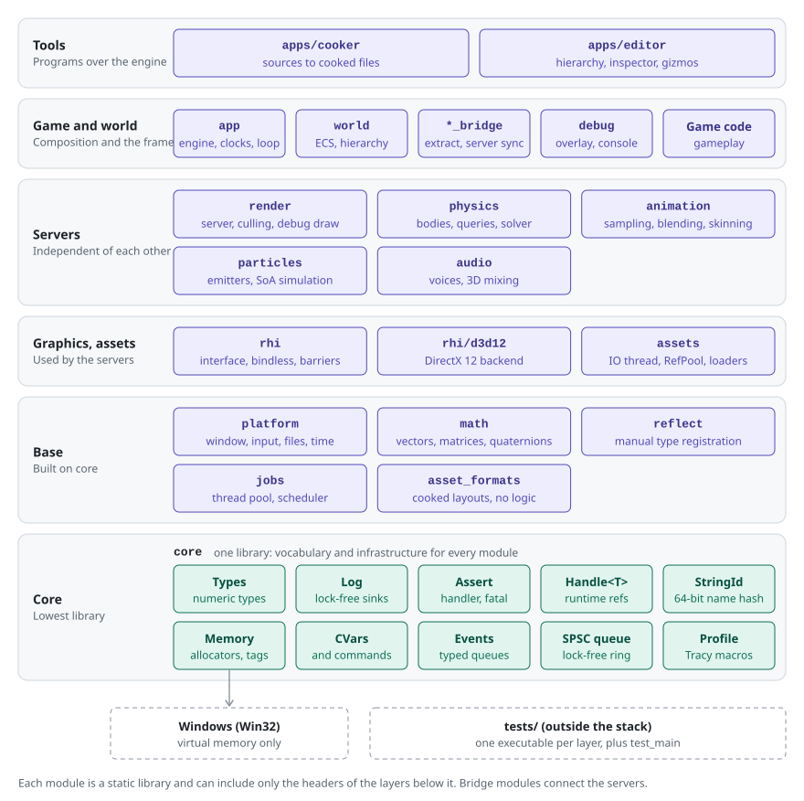
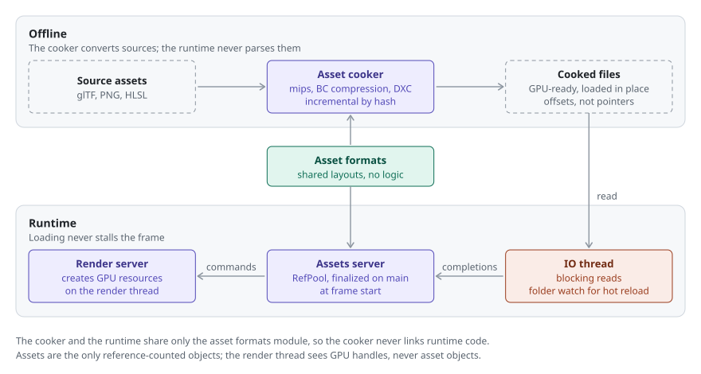
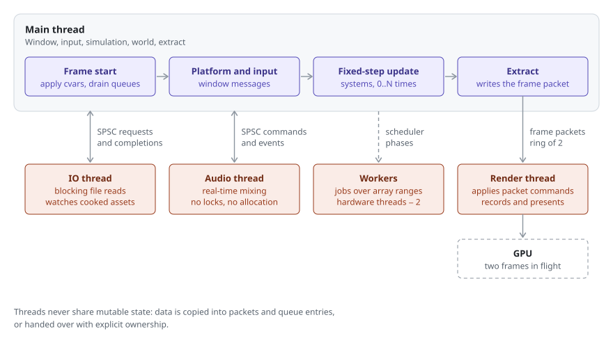
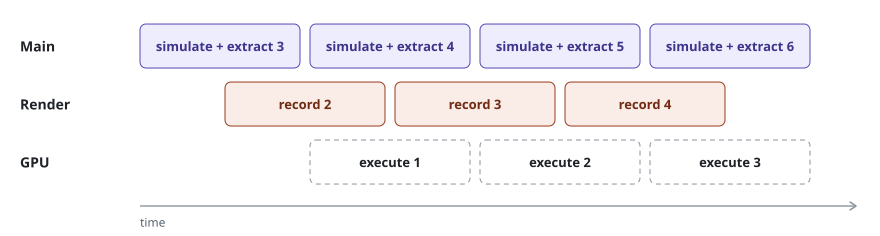

# Architecture

Aurora is organized in layers. Each layer is a static library that depends only on the layers below it. This document describes the layers, how a frame runs, which threads exist and the rules every system follows for concurrency and ownership.

## Layers

<picture>
  <source media="(prefers-color-scheme: dark)" srcset="images/architecture-dark.svg">
  
</picture>

| Layer | Modules | Responsibility |
|---|---|---|
| Tools | `editor`, `cooker`, console UI | Programs and overlays that use the engine as a library. The game never depends on the editor or the cooker. |
| Game and world | game code, `world` | Entities, components, systems, the transform hierarchy, event queues and the frame loop |
| Servers | `render`, `physics`, `audio`, `assets`, `animation`, `particles` | Self-contained subsystems with low-level, handle-based APIs |
| Graphics abstraction | `rhi` | A thin interface over DirectX 12: resources, bindless descriptors, barriers, command lists |
| Base | `math`, `jobs`, `reflect`, `platform`, `asset_formats` | Math library, thread pool, type registration, window, input, files and time, cooked-format definitions |
| Core | `core` | Types, log, assert, handles, memory, console variables and commands, events |

`asset_formats` holds only the definitions of the cooked file formats, with no logic, and depends only on `core`. Both the cooker and the runtime asset server link it, so the cooker never links runtime code.

Only `core` exists today. See the [roadmap](roadmap.md) for the order in which the others arrive.

### The layer rule

Each layer is created with `engine_add_layer()` and exposes only its own `include/` folder. A layer can include only the headers of the layers it links. If `core` tried to include `"platform/window.h"`, the build would fail, because that path does not exist for `core`. The architecture is checked by the compiler, not by convention. See [Building](build.md#adding-a-layer).

There is one exception: `core` calls the operating system for virtual memory, in a single file (`core/src/win32/virtual_memory.cpp`), because arenas and pools live in `core` and need pages from the OS. Everything else that touches the OS (window, input, files, time) belongs to `platform`.

The order in which layers are *implemented* is not the layer order. A system gets its first version when its first real user exists: the job system comes after the systems it will parallelize, reflection after the ECS it will describe. Layers constrain who may include whom, not when code is written.

## Key ideas

1. **Generational handles instead of pointers.** Objects refer to each other through `Handle<T>`, an index plus a generation. A handle to a destroyed object is detected instead of pointing at whatever now lives in its slot. See [Pools and handles](core/memory/pools.md).
2. **Explicit ownership, no garbage collector.** Every allocation has an owner that frees it: a pool, an arena, a level. Reference counting is used only for assets, the one case of shared ownership with an unknown last owner. See [Choosing an allocator](core/memory/README.md).
3. **ECS with a transform hierarchy.** Components live in dense arrays; systems run over queries; a parent/child component keeps scene building comfortable.
4. **Servers with handle-based APIs.** `render.create_mesh(...)` returns a handle; the world stores handles in components; systems synchronize world and servers each frame.
5. **An extract step between the world and the renderer.** The renderer never reads the world. At a fixed point in the frame, the data rendering needs is copied into a frame packet.
6. **A thin RHI over DirectX 12**, extracted from a working triangle rather than designed up front.
7. **Typed event queues** instead of a global event bus.
8. **Cooked assets only at runtime.** Source formats (glTF, PNG, HLSL) are converted offline; the runtime loads binary, GPU-ready data.

<picture>
  <source media="(prefers-color-scheme: dark)" srcset="images/asset-pipeline-dark.svg">
  
</picture>

## Frame loop

```
Platform events -> Input -> Fixed-step update (0..N times) -> Extract -> Render -> Present
       ^                                                                             |
       +---------------------------------- next frame -------------------------------+
```

- The simulation runs at a fixed step of 1/60 s with an accumulator. Frame time is clamped to 0.25 s, so a long stall does not cause a burst of catch-up steps.
- Console variable writes and commands queued during a frame are applied at the start of the next one.

## Threads

Aurora uses a few threads with fixed roles, and later a pool of workers.

| Thread | Arrives in | Owns | Talks to others through |
|---|---|---|---|
| Main | now | Window and OS messages, input, simulation, world, extract | Frame packets to render; request queue to IO; command queue to audio |
| Render | step 8 | DirectX 12 device, command recording, GPU resources | Consumes one frame packet per frame |
| IO | step 9 | File reads, watching cooked assets in development | Request and completion queues |
| Audio | step 17 (created by miniaudio) | Mixing, in a real-time callback | Lock-free command and event queues |
| Workers | step 17 | Nothing long-lived: jobs over ranges of data | Scheduler phases |

<picture>
  <source media="(prefers-color-scheme: dark)" srcset="images/threads-dark.svg">
  
</picture>

<picture>
  <source media="(prefers-color-scheme: dark)" srcset="images/frame-pipeline-dark.svg">
  
</picture>

The main thread simulates frame *k+1* while the render thread records frame *k* and the GPU executes frame *k−1*. Data crossing threads is copied (frame packets, queue entries) or handed over with explicit ownership; threads never share mutable state.

## Concurrency guidelines

Every system follows this order of preference:

| # | Approach | Example |
|---|---|---|
| 1 | **No sharing**: one owner per structure, per-thread data | Arenas, per-thread scratch arenas, pools owned by one system |
| 2 | **Phases**: in each phase, data is read-only or has a single writer; synchronize at the boundary | Event queues, the ECS scheduler, the extract step |
| 3 | **Copy or transfer ownership**: the message carries the data | Frame packets, IO buffers |
| 4 | **Small, tested lock-free primitives** | Log sinks, reference counts, the pending list of `RefPool` |
| 5 | **Locks on cold paths only**, documented | The Debug callsite registry of the heap |

Rules:

- A new lock-free structure needs a measured reason and its own stress tests.
- Every atomic operation states its memory ordering explicitly.
- No long spin-waits: a thread that must sleep waits on an event or a semaphore.
- No locks on hot paths or on real-time threads (audio).
- Where a hidden lock remains (the C runtime inside `fprintf`, rare paths inside mimalloc), the documentation says so.

Before adding a shared structure, answer: who writes it, who reads it, on which thread or in which phase, how they synchronize, which lock remains, and how it is tested.

How other engines approach the same problem is summarized in [Choosing an allocator](core/memory/README.md#concurrency).

## Ownership

Every allocation names its owner and its lifetime pattern, and the allocator follows from that. [Choosing an allocator](core/memory/README.md) has the decision table.

## Conventions

- Namespace `aurora`. Every macro starts with `AURORA_`. Targets are aliased `aurora::<layer>`.
- Public headers live in `<layer>/include/<layer>/` and are included as `#include "<layer>/file.h"`.
- No exceptions in engine code. Programming errors are assertions; expected failures are return values. Test code may use exceptions.
- UTF-8 everywhere. Conversion to UTF-16 happens only inside Win32 code.
- Engine code avoids deep inheritance and virtual calls on hot paths; interfaces are for boundaries such as the RHI.
- Code comments are short and explain only what the code cannot say. Contracts and rationale live in these documents.
- Math: right-handed, Y up, column vectors, column-major matrices, reversed-Z depth, radians.
