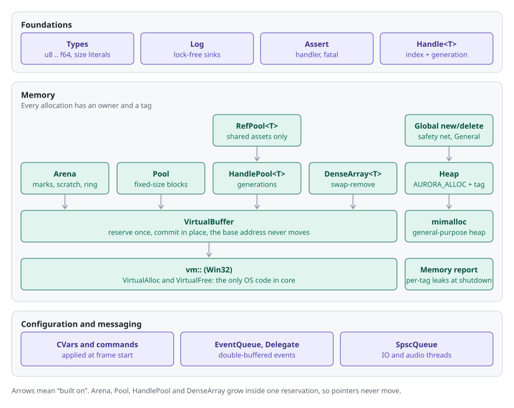

# Core layer

`core` is the lowest library of the engine. Every other layer links it; it links nothing from the engine. It contains the vocabulary every file uses (types, logging, assertions), the memory infrastructure, and later console variables and events.

```
engine/core/
├── include/core/
│   ├── types.h            numeric types, size literals
│   ├── log.h              AURORA_LOG_*
│   ├── assert.h           AURORA_ASSERT, AURORA_FATAL, AURORA_UNREACHABLE
│   ├── handle.h           Handle<T>
│   └── memory/            allocators, tags, report
└── src/
    ├── log.cpp, assert.cpp
    ├── memory/            allocator implementations
    └── win32/             virtual_memory.cpp: the only Windows code in core
```

## Modules

<picture>
  <source media="(prefers-color-scheme: dark)" srcset="../images/core-dark.svg">
  
</picture>


| Module | Header | Guide |
|---|---|---|
| Types | `core/types.h` | [types.md](types.md) |
| Logging | `core/log.h` | [logging.md](logging.md) |
| Assertions | `core/assert.h` | [assertions.md](assertions.md) |
| Memory | `core/memory/*.h`, `core/handle.h` | [memory/README.md](memory/README.md) |
| Console variables and commands | — | Planned (1.11) |
| Events | — | Planned (1.12) |

## What core may and may not do

- `core` uses the C++ standard library, which already wraps the operating system (stdio, `<format>`, `<atomic>`, `thread_local`).
- The only direct operating-system calls are for virtual memory, in `src/win32/virtual_memory.cpp`. Window, input, files and time belong to the `platform` layer.
- `core` has one third-party dependency, mimalloc, linked privately: no public core header includes it.

## Thread safety at a glance

| Component | Contract |
|---|---|
| Logging | Any thread. Sinks are added by the main thread only |
| Assertions | Any thread. The assert handler is set by the main thread before other threads start |
| Heap | Any thread |
| `VirtualBuffer`, `Arena`, `Pool`, `HandlePool`, `DenseArray` | One owner, on its thread |
| Scratch arenas | One pair per thread |
| `Ref<T>` copies and destruction | Any thread; the owner of the `RefPool` creates, mutates and collects |
