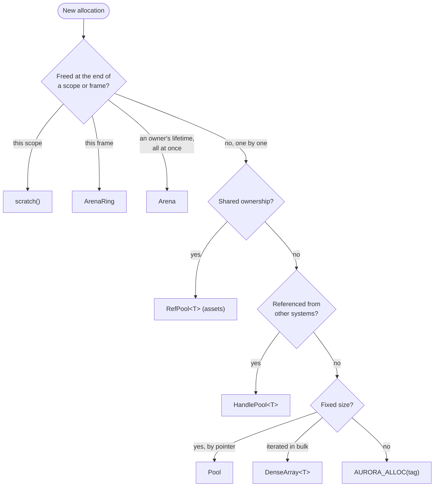

# Memory: choosing an allocator

Aurora has no garbage collector and almost no general-purpose allocation on hot paths. Every allocation has an **owner** that frees it and a **lifetime pattern**, and the lifetime pattern chooses the allocator.

## The question to ask

> Who owns this memory, and when is it freed?

| Lifetime pattern | Use | Typical data |
|---|---|---|
| Only during this function or scope | [`scratch()`](arena.md#scratch-arenas) | Temporary lists, intermediate buffers, string building |
| This frame, passed between systems | [`ArenaRing`](arena.md#the-frame-ring) (frame arena) | Extracted render data, per-frame command lists |
| A larger scope with a clear owner, freed all at once | [`Arena`](arena.md) owned by that system | Loading temporaries, a menu's data, a level's transient data |
| Many objects of one size, freed one by one, referenced by pointer | [`Pool`](pools.md#pool) | Internal nodes of a system (tree nodes, job descriptors) |
| Objects referenced from elsewhere, freed one by one | [`HandlePool<T>`](pools.md#handlepool) | Server resources: meshes, textures, rigid bodies, voices |
| Shared, with no single last owner | [`RefPool<T>`](ref-pool.md) | Assets |
| Elements iterated in bulk, order irrelevant | [`DenseArray<T>`](dense-array.md) | ECS component columns, particle attributes |
| Variable size, arbitrary lifetime | [`AURORA_ALLOC`](heap.md) with a tag | Asset payloads, IO buffers, mesh data before upload |
| Standard containers and foreign code | Global `new` (counted automatically) | `std::vector`, `std::string`, third-party code |



## How the pieces fit together

```
                    operating system pages
                             |
                     vm:: (reserve/commit)
                             |
                       VirtualBuffer  ---- committed bytes counted per tag
          +--------+--------+---------+-----------+
          |        |        |         |           |
        Arena    Pool   HandlePool  DenseArray   (RefPool = HandlePool + counts)
          |
   scratch, ArenaRing

   mimalloc --- heap::alloc / AURORA_ALLOC / global new --- per-tag statistics
```

- [Virtual memory](virtual-memory.md) is the base. A `VirtualBuffer` reserves a large range of address space and commits pages as it grows, so **its base address never changes**. Arenas, pools and dense arrays are built on it, which is why none of them ever reallocates or moves their contents.
- The [heap](heap.md) (mimalloc) serves everything of variable size and arbitrary lifetime.
- The [memory report](memory-report.md) reads the counters of both and lists what is still alive.

## Memory tags

Every allocation carries a `MemoryTag` that names the subsystem it belongs to:

| Tag | Used by |
|---|---|
| `General` | Global `new`/`delete`: standard containers, foreign code |
| `Core` | Core's own allocations, scratch arenas |
| `Debug` | Debug tools, tests |

Tags are added when a subsystem's first user appears (`Render`, `Physics`, `Assets` and so on arrive with their steps). Tags make the memory report say "Assets: 120 MB" instead of "300 MB somewhere".

## Rules

1. **Name the owner.** Every allocation belongs to something that frees it, usually in bulk.
2. **Engine systems use `AURORA_ALLOC` with their own tag** for variable-size blocks. The global `new` is a safety net that counts standard containers and foreign code under `General`.
3. **No raw `new T` / `delete` for engine objects.** They live in pools, arenas or as members of their owner.
4. **Third-party libraries are connected to the heap** through their allocation hooks when they are integrated, so their memory shows up under the right tag.
5. **Exhausting a fixed reservation is fatal** (arenas, pools, dense arrays). Reservations are sized generously: address space on x64 is 128 TB, and reserving costs nothing until pages are committed. Each structure reports its high-water mark so reservations can be sized from real data.

## Concurrency

All allocators except the heap have **one owner** and no internal synchronization. That is a choice, not a missing feature. Engines in general put concurrency only where allocation and release inherently cross threads, and use per-thread memory everywhere else:

| Kind of allocator | What engines do |
|---|---|
| Virtual memory | Never a concurrent structure. The OS calls are thread-safe; the allocator above synchronizes |
| Linear (arenas) | Per thread (Unity's TLS stack allocator for `Allocator.Temp`, Unreal's `FMemStack`), or shared with an atomic bump pointer for job data with a short lifetime (Unity's thread-safe linear allocator for `Allocator.TempJob`) |
| Fixed-size pools | Single-threaded with an optional lock (Godot's `PagedAllocator<T, thread_safe>`), or lock-free with per-thread caches where objects are created on one thread and freed on another (Unreal's TaskGraph task allocator) |
| Handles and IDs | Reserved concurrently and created at a sync point (Bevy's entity reservation and flush) |
| General heap | Per-thread caches (mimalloc) |

Aurora follows the same pattern: per-thread [scratch arenas](arena.md#scratch-arenas) today; concurrent allocators for jobs arrive with the job system (step 17), when there is something to measure. The one lock-free structure so far is the release list of [`RefPool`](ref-pool.md), because references are dropped on any thread by design.

A lock-free free list shared by several threads has the **ABA problem**: between reading the top of the list and swapping it, another thread can pop that block and push it back, and the swap succeeds on a list that changed underneath. Arenas do not have this problem (their position only grows), and neither does `RefPool`'s list (threads only push; only the owner removes, and it takes the whole list at once).

## Debug features

| Feature | Where |
|---|---|
| File and line of each heap allocation | [Heap](heap.md#debug-callsite-registry) |
| Freed heap blocks, rewound arena memory and destroyed pool objects filled with `0xDD` | All allocators |
| Double free, foreign pointer and wrong-tag detection | Heap, `Pool` |
| Stale handles detected | `HandlePool`, `RefPool` |
| Live memory per tag at any time | [Memory report](memory-report.md) |
